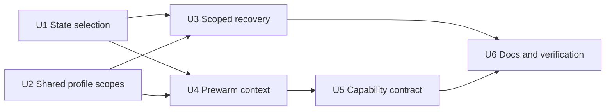

# Repair Plugin Configuration and State Consistency - Plan

## Goal Capsule

**Objective:** Users of Daily Tasks in OpenClaw, Claude Code, and Codex can reopen their established workspace, continue independent planning during recovery, and use the same supported configuration through every relevant entry point.

**Means:** Repair state selection, shared profile interpretation, recovery scoping, prewarm context transport, and the published profile schema in the existing feature modules (KTD1–KTD5).

**Authority:** The user's request to repair the five reviewed issues sets scope. Repository `AGENTS.md` and `docs/requirements.md` constrain implementation; canonical `skills/` instructions own the conversational workflows. This plan supplies the implementation contract without authorizing new automation, state migration, or record acceptance.

**Execution and ownership:** This is a code implementation plan for `ce-work`. The implementing agent owns all units, regression coverage, generated artifacts, and the completion report. This planning request does not itself authorize implementation, publication, or merging.

**Stop conditions:** Stop a write when authoritative state differs, an affected operation cannot be safely classified, or accepted source pointers no longer resolve. Report the exact scope and next recovery action. A missing host runtime limits evidence for that host; it does not justify claiming host activation from CLI tests.

## Product Contract

### Summary

Repair the five confirmed defects from the plugin review. Preserve the Markdown-first workflow, accepted configuration locations, and script-owned event log. Changes should make existing operations consistent across hosts, without adding a new workflow or storage format.

### Problem Frame

| Finding | Observed failure | User consequence |
|---|---|---|
| F1: explicit state selection | `resolveStateRoot` returns an empty explicit directory even when another discovered location has operating history. | A continuation appears to lose review or recovery state. |
| F2: recovery scope | Any pending checkpoint makes planning preparation `recovery-required`, and saving the review rejects that status. | An unrelated conflict prevents every numbered planning screen. |
| F3: prewarm context | Warm CLI and OpenClaw registration carry only a single optional profile path. | A valid layered custom configuration works in the library but fails through prewarm. |
| F4: coincident roots | The same v2 profile is validated as both user and project when home and workspace coincide. | Legal project bindings make the workspace unusable; writable template stores also alias. |
| F5: advertised schema | Generated `validate-profile` metadata requires complete v1 fields for every input. | Consumers reject supported partial v2 profiles before the runtime sees them. |

### Requirements

#### Established configuration and state

- **R1 — Authoritative history:** An explicit empty state root must not conceal authoritative history elsewhere. Keep an established explicit root when it contains the authoritative state, including identical duplicate stores. Divergent stores require reconciliation. Profile, template, and derived-cache contents alone do not establish operating history. No automatic move, copy, deletion, or migration is permitted.
- **R2 — Shared home/workspace:** A valid v2 profile works when home and workspace resolve to the same path. A later personal-only session or another workspace can reuse its preference fields without inheriting the home workspace's binding fields. Reading and editing preserve accepted paths and existing project bindings. When two scopes share one physical profile or template store, surface that shared ownership; do not promise independent preferences in a single file. Existing distinct accepted pointers continue to provide independent scopes.
- **R3 — Context continuity:** Continue with the selected user/project source descriptor, including deliberate null absences, bound roots, and established state root. Preserve legacy exclusive profile invocation. Reopening from another cwd must not select another workspace. Ordinary setup reuses existing settings before requesting missing scope.

#### Planning and recovery

- **R4 — Independent progress:** A pending operation with a validated scope disjoint from the current planning dependencies remains visible but does not prevent an independent numbered review and save. Affected records and actions remain suspended. Do not erase existing selections, renumber unaffected rows, infer acceptance, or mark the whole vault healthy while pending work remains. Unknown or malformed scope cannot qualify as unrelated.
- **R5 — Fresh evidence:** Saving a review revalidates its dependency and checkpoint evidence. A relevant operation introduced or changed after preparation prevents a stale save. Inspection does not complete or remove checkpoints, append events, or write record Markdown.

#### Entry-point consistency

- **R6 — Prewarm parity:** Portable warm CLI and the existing optional OpenClaw prewarm can replay the supported context in R3. Persist only durable selectors, not a one-off preference override, effective profile, fixed clock, or local date. Reject invalid or ambiguous input before registration. Keep existing registration identity and operator-disabled behavior for unchanged legacy invocations; equivalent new invocations reconcile to one identity.
- **R7 — Accurate capabilities:** Published `validate-profile` input metadata describes supported v1 and partial v2 inputs, with their different requirements and null semantics. Metadata and runtime validation must agree on representative valid and invalid inputs. Effective workspace completeness remains a separate check.
- **R8 — Canonical host behavior:** Amend canonical skills and generators, then regenerate host artifacts. Codex and Claude Code use the same repaired primitives; OpenClaw adds only the adapter transport needed by R6. Evidence distinguishes behavioral tests, package validation, and actual host workflow acceptance.

### Acceptance Examples

| Example | Expected result |
|---|---|
| AE1: empty explicit canonical/custom state root; populated legacy state | Resolution fails with the requested and authoritative paths and recovery guidance; nothing is moved or written. |
| AE2: pending task edit in project B; independent review in project A | B remains visibly suspended, A can be numbered and saved, and whole-vault maintenance still reports pending work. |
| AE3: an operation touches today's plan or the selected task after review preparation | The save refuses stale evidence and requires a refreshed review. |
| AE4: identity in a user profile, bindings in a custom project profile | Library, warm subprocess, and serialized OpenClaw command resolve the same context, including an established custom state root. |
| AE5: v2 profile in the workspace that is also home | Planning resolves; descriptor replay agrees. Personal-only and another-workspace reads see preferences but no inherited home-workspace bindings. |
| AE6: `{ "schema_version": 2, "timezone": "UTC" }` | Capability validation and runtime profile validation accept the partial layer. Resolution may still request identity and workspace bindings. |

### Scope Boundaries

**Included:** The five repairs, their shared-context consequences, focused regression tests, relevant canonical instructions, and generated metadata/manifests.

**Deferred:** Broad Tessl skill restructuring, unrelated evaluation-report freshness/line-ending cleanup, and full certification of every host workflow.

**Excluded:** New scheduling features, implicit automation consent, automatic configuration/state migration, a new profile version, new generic utilities, dependency adoption without a concrete need, and changes to task acceptance or log ownership. Prewarm verification uses synthetic fixtures and registration mocks; it does not create a live automation.

## Planning Contract

### Key Technical Decisions

**KTD1 — Refuse a contradictory explicit state binding.** Retain the existing content-based discovery and comparison in `lib/profile/context.mjs`. After comparing authoritative stores, honor an explicit root only if no authoritative store exists or that explicit root belongs to the identical authoritative set. An empty explicit target beside populated history is an actionable error. Silently redirecting it would violate a continuation's accepted binding; copying history would introduce migration ownership. No new manifest or storage format is needed.

**KTD2 — Separate a shared document from its scope views.** Use existing normalized path equivalence to read a selected physical source once. For a selected stored v2 profile, conventional or explicitly accepted custom, validate the complete document as a project-capable layer, then project only allowed preference fields into its user view. This lets a custom shared profile reopen in personal-only or another-workspace sessions without additional descriptor state. Apply binding fields only when that physical source is selected as the project source for the bound workspace; validate any stored vault binding against that workspace. Keep ordinary user-layer validation strict for the projected view, user-scope edits, and transient overrides. Stored-document validation must still expose malformed project fields before projection.

Keep the existing descriptor shape and faithfully return selected paths/null absences. Same-file user/project selections round-trip to the same views; explicit absence stays absent. Distinct custom sources keep normal precedence. Personal-scope edits validate the changed preference leaves, merge into the retained document, and preserve project fields. Project edits preserve unrelated personal leaves. Setup owns these Markdown/JSON workflow decisions; the resolver does not acquire a profile writer.

One physical profile/template store cannot hold independently scoped preferences. Report aliased scopes in context/template preparation, read each physical store once, and produce one write intent with accurate ownership. A preference update to the shared home store is visible to every session using its user view. Canonical setup/template guidance must state that effect before presenting an update choice; isolated project overrides require an accepted distinct source, not silent relocation. Keep existing template optimistic tokens and scope checks, including the explicit personal action's no-project-log rule. Relative template pointers retain their documented vault/home-relative meaning in each bound session.

**KTD3 — Gate planning on validated impacts.** Extend the existing operation checkpoint reader with a read-only impact summary, reusing or extracting validation already owned by `lib/operations/verification.mjs`. Retain the names API for whole-vault maintenance. Validate operation identity, context, effect paths, protected paths, and typed state effects before declaring independence. Do not implement another weaker checkpoint parser or a generic dependency framework.

Classify the current action against today's and rollover-source plans, dated review/selection/rollover state, selected tasks, and the project/milestone dependencies used for eligibility and first-open ordering. Unrelated operations are diagnostics. Record-level impacts suspend affected additions and preserve existing selections with unresolved diagnostics; project/milestone impacts may suspend that project's additions. Overlap with the current plan or required planning state blocks that save. Invalid/unclassifiable checkpoints block the action conservatively. Foreign-bound operations remain unrecoverable in this session and may be called unrelated only when validated effects prove disjointness.

Carry a deterministic fingerprint of relevant checkpoint classification in preparation evidence. Recompute classification during save, validate it with the existing hashes/tokens, and repeat the existing optimistic recheck before atomic replacement. A fresh preparation may continue once a changed checkpoint is proven unrelated; no new global lock or automatic checkpoint completion is introduced.

**KTD4 — Carry durable context through exact argv.** Add `--configuration-sources` containing one JSON argv value and `--state-root` to the warm CLI and OpenClaw setup-prewarm path. Keep vault/home/profile flags. Reuse resolver validation; layered sources and legacy exclusive selectors remain mutually exclusive. Build command arguments as an array, never by shell concatenation. Allowlist roots, source selections, and state binding when constructing the persisted declaration. Each execution rereads selected profiles and obtains its current time normally.

Keep the exact existing declaration-key algorithm for unchanged legacy invocation shapes. For the new form, canonicalize path identity and descriptor fields, preserving nulls, and include the state binding. Property order, Windows path casing, and interval changes must not create duplicates. Changing the source binding creates a different declaration; do not describe it as updating an old job. Canonical setup guidance must explain that distinction and, when replacing a known job, have the operator explicitly choose its disable/removal and replacement through the host's supported controls before adding the replacement. Verify those controls when writing the guidance. The adapter continues submitting a single declaration; automated inventory discovery, cross-declaration reconciliation, and migration are outside this repair.

JSON argv fits the existing persisted command declaration. A durable request file would create another mutable configuration owner and stale-pointer lifecycle; a temporary file could disappear before a scheduled execution. Those alternatives are unnecessary for this repair.

**KTD5 — Generate an honest profile input contract.** Fix `scripts/write-capabilities.mjs`, not just its output. Define disjoint v1/v2 branches with supported fields, nested preference leaves, omissions, and allowed resets derived from `lib/profile/profile.mjs`. Preserve the runtime's accepted legacy discriminator behavior if it allows omission. Represent structural constraints in JSON Schema; retain semantic checks such as timezone validity in the runtime with explicit metadata documentation. Do not claim JSON Schema alone resolves paths or produces a complete workspace context.

Keep schema definitions in the profile feature if reuse prevents generator/runtime drift, without replacing the existing validator or introducing a schema engine. Add focused contract checks for the emitted branches and fixture agreement using the repository's dependency-free test patterns; do not build a general JSON Schema evaluator. Update warm operation metadata for KTD4 in the same generator.

### Sequence and Assumptions

Land the work as one cohesive change: U1 and U2 establish context semantics, U3 and U4 consume them, U5 aligns the published contract, and U6 checks canonical/generated parity. U5's profile portion can be developed independently; its prewarm metadata depends on U4. Use one integration owner for `context.mjs`, shared tests, and the generator.

The review's source traces and synthetic reproductions establish the failure paths; planning does not rerun probes. No new external research is needed to select these internal repairs. Existing modules provide the required mechanisms, so no competing architecture needs a bake-off. Routine implementation choices remain with the implementer; there is no unresolved product choice blocking work.

## Implementation Units

### U1. Preserve authoritative state during explicit resolution

**Goal:** Repair F1 under KTD1. **Requirements:** R1, R3. **Dependencies:** None.

**Files:** `lib/profile/context.mjs`, `test/context.test.mjs`.

**Approach and patterns:** Adjust the explicit-selection branch after the existing authoritative content comparison. Include useful requested/discovered paths in its error without dumping state contents. Preserve legacy discovery order, symlink rejection, and cache exclusions.

**Test scenarios:** Empty canonical and custom explicit roots beside populated legacy history; no history anywhere; explicit populated root; identical copies; divergent copies; cache/profile/template-only directories; missing explicit directory; normalized equivalent paths; context reopened from another cwd. Assert failure cases make no writes.

**Verification:** Focused context tests reproduce F1 before the fix and pass afterward. Existing legacy state and divergent-store behavior remains covered.

### U2. Resolve and edit coincident configuration scopes consistently

**Goal:** Repair F4 under KTD2. **Requirements:** R2, R3. **Dependencies:** U1's shared context changes reconciled before integration.

**Files:** `lib/profile/context.mjs`, `lib/profile/profile.mjs` only if scope projection needs feature-owned metadata, `lib/templates/templates.mjs`, `test/context.test.mjs`, `test/template-updates.test.mjs`, `skills/daily-tasks-setup/SKILL.md`, relevant canonical template reference.

**Approach and patterns:** Separate source loading from scope-specific views. Preserve returned descriptor semantics, source attribution, writable-scope metadata, and effective-profile completeness checks. Deduplicate template-store loading/write intent by the same path identity. Amend setup's merge instructions rather than creating a new profile-writing runtime workflow.

**Test scenarios:** Shared v2 and legacy v1 profiles; conventional and accepted custom shared v2 sources on personal-only reentry and in another bound workspace; descriptor replay; Windows equivalent path casing; explicit null user/project absence; same-file explicit pointers; distinct custom pointers with equal roots; malformed project bindings; personal edit preserving bindings; shared template update producing one write and stable optimistic token. Validate that another workspace never inherits the home binding, explicit personal actions do not append project events, and alias notices describe preference effects accurately.

**Verification:** Context and template tests pass. A synthetic setup trace demonstrates scoped merge preservation and accepted-pointer reuse without migration.

### U3. Permit planning outside affected recovery scope

**Goal:** Repair F2 under KTD3. **Requirements:** R4, R5. **Dependencies:** U1, U2.

**Files:** `lib/operations/checkpoints.mjs`, `lib/operations/verification.mjs`, `lib/planning/session.mjs`, `lib/planning/review.mjs` as needed for existing exclusion hooks, `test/planning-screen.test.mjs`, `test/recovery-flow.test.mjs`, `test/maintenance.test.mjs`.

**Approach and patterns:** Reuse validated checkpoint effects and the planning review's exclusion/unsafe-project mechanism. Add affected-operation diagnostics and evidence to preparation; save independently reclassifies. Preserve review-screen validation, inventory/plan/state hashes, stable mappings, and whole-vault maintenance semantics.

**Test scenarios:** AE2 and AE3; empty plan plus unrelated conflict; selected task impact; milestone ordering impact; current and rollover-source plan impact; disjoint future-plan operation; typed state impact; protected-file dependency; malformed/unsafe/unknown checkpoint; foreign binding; retained legacy completed receipt; checkpoint added/changed between prepare and save. Assert checkpoint files, canonical records, and log remain unchanged during inspection, and independent save does not clear pending maintenance status.

**Verification:** Planning/recovery/maintenance suites pass with real checkpoint shapes from existing fixtures, including rejection tests that would fail if the global guard were simply removed.

### U4. Preserve layered context through prewarm

**Goal:** Repair F3 under KTD4. **Requirements:** R3, R6. **Dependencies:** U1, U2.

**Files:** `bin/warm-project-index.mjs`, `adapters/openclaw/cli.mjs`, `adapters/openclaw/automation.mjs`, `lib/inventory/warm.mjs` only if propagation requires it, `test/prewarm.test.mjs`.

**Approach and patterns:** Parse the new durable selectors at each CLI boundary, pass them to the resolver, and serialize a validated exact argv declaration. Retain the existing disabled/dry-run/no-chat/no-model behavior and legacy registration key. Update canonical setup guidance for explicit replacement of a known differently bound job; keep job discovery and lifecycle management in the host's controls.

**Test scenarios:** AE4 through an actual warm subprocess and a mocked native registration; custom paths with spaces; alternate cwd; explicit null source staying absent after a conventional profile appears; malformed JSON; mixed selectors; missing selected file; stale explicit state binding; equivalent reordered descriptors; interval-only changes; unchanged old-form key. Walk the setup replacement guidance with a known old declaration and explicit operator choice, ensuring the new identity is not described as implicit reconciliation. Prove overrides/clocks/effective profiles never enter persisted payloads and prewarm does not edit record Markdown.

**Verification:** Prewarm tests execute the generated argv against the portable CLI where possible, check registration payloads, and establish idempotence without registering a live job.

### U5. Align generated capability schemas with supported inputs

**Goal:** Repair F5 under KTD5. **Requirements:** R7, R8. **Dependencies:** U4 for warm metadata; profile schema work independent.

**Files:** `scripts/write-capabilities.mjs`, `capabilities.json` (generated), `scripts/validate.mjs`, a focused `test/capabilities.test.mjs`, profile schema metadata only if justified by KTD5.

**Approach and patterns:** Replace the one-size v1 required list for `validate-profile` with explicit versioned branches. Add a targeted validator check so malformed/missing branches and required-field drift fail repository validation. Include U4 selectors in warm metadata. Test the generated artifact and fixture decisions rather than snapshotting the generator's implementation.

**Test scenarios:** Full valid v1; incomplete/invalid v1; minimal v2 (AE6); supported v2 identity/preferences/bindings; supported null resets; disallowed null identity/bindings; unsupported versions; invalid nested leaves; missing discriminator according to current runtime behavior. Structural examples agree with runtime validity; semantic-only differences are explicitly documented and tested at the runtime boundary.

**Verification:** Focused capability/profile tests plus generation/check validate the public artifact. No schema engine dependency is added solely for these checks.

### U6. Reconcile instructions and verify the integrated repair

**Goal:** Keep the repaired behavior consistent across public docs and generated host packages. **Requirements:** R1–R8. **Dependencies:** U1–U5.

**Files:** `docs/requirements.md`, `skills/daily-tasks/references/cli.md`, `skills/daily-tasks/references/operations.md`, planning/setup/template references affected by U2–U4, generated artifacts owned by `scripts/assemble.mjs`, existing eval fixtures only where they exercise these repairs.

**Approach and patterns:** State each changed contract once in its canonical owner and link from other skills. Use Tessl's actionability and progressive-disclosure principles: concise activation descriptions, explicit inputs, actionable conflict messages, and focused references. Regenerate all host copies; avoid hand-editing them or broad unrelated prose cleanup.

**Test scenarios:** Walk AE1–AE6 through canonical instructions, checking whether an agent receives sufficient context to continue or recover. When a host is available, run the synthetic host acceptance below and record exactly which workflow was observed. Missing host access remains unverified, not a failed code regression or a claimed pass.

**Verification:** Complete the Verification Contract, reconcile generated diff, and produce a concise report of fixes, test results, and host evidence limits.

## Verification Contract

Implementation must first add a regression that demonstrates each observed failure, then run focused tests for its unit. Planning itself does not execute these tests.

- Run relevant `node --test` files for U1–U5, then `npm test` once after integration. Use synthetic data and the repository's temporary-directory conventions.
- Regenerate with `node scripts/assemble.mjs write`, then run `npm run check`. Review generated capability and host-artifact changes for parity with canonical sources.
- Run `claude plugin validate artifacts/portable` when Claude Code is available. This is package validation only.
- Inspect `npm run eval:check` separately from behavioral tests. The review found pre-existing stale evidence/report differences; report them accurately and do not regenerate acceptance claims merely to make the report green.
- Run the filesystem-sensitive suite on a runner that can create test symlinks. The preceding Windows review had 282 passes and two `EPERM` failures in `test/navigation.test.mjs` and `test/operation-verification.test.mjs`. Do not weaken path-safety tests or call that run fully passing. Obtain a capable Windows run or equivalent supported CI coverage, naming any remaining platform gap.
- For each available OpenClaw, Claude Code, and Codex host, use synthetic layered custom profiles to resolve a workspace, display/save an independent review with an unrelated checkpoint, and confirm an affected operation is suspended. For OpenClaw also inspect a dry-run prewarm declaration. Record host/version, exact scenario, outcome, and evidence path; never start a live schedule for verification. If a host cannot be exercised, retain an explicit unverified entry and avoid host-activation claims.

### Evidence Baseline and Limits

The preceding review reproduced all five issues and found `npm run check` and portable Claude package validation passing. The full test run had the two environment-related failures above. Existing host workflow-v4 evidence was unverified, and the hosted Tessl review could not run because its workspace had no credits. These are prior observations, not results from this planning session. The repair does not depend on obtaining a new Tessl score.

Research for this plan inspected the resolver, profile validator, planning session/review, operation checkpoint/verification code, template state, prewarm CLI/adapter, generator, and corresponding tests. Source evidence is anchored to the reviewed `main` revision `5644918bd3679b7c6db5d367dd25586de18170f7`; recheck relevant behavior if the implementation starts from a changed baseline.

## Definition of Done

- Every R-ID has implementation and regression coverage through its named units; AE1–AE6 produce the specified results.
- Existing explicit/legacy configuration and state remain in place, source nulls round-trip, and no unrelated task acceptance, scheduling, or logging behavior changes.
- Focused tests, the integrated suite on an appropriate runner, and generation/validation checks pass; any pre-existing evidence or platform limitation is separately documented.
- Canonical instructions, capability metadata, and generated host copies agree. Public artifacts contain only synthetic data.
- Remove abandoned parser branches, duplicate checkpoint validation, unused helpers, and temporary implementation scaffolding. Keep one owner for each new rule.
- The completion report separates tested primitive behavior from observed host behavior and states any host still unverified. Shipping follows the user's subsequent implementation/release instruction.
